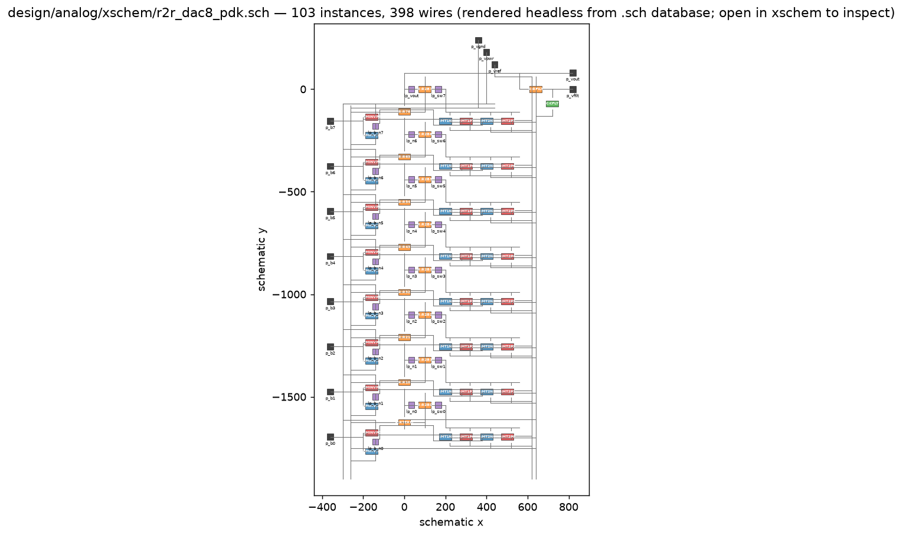
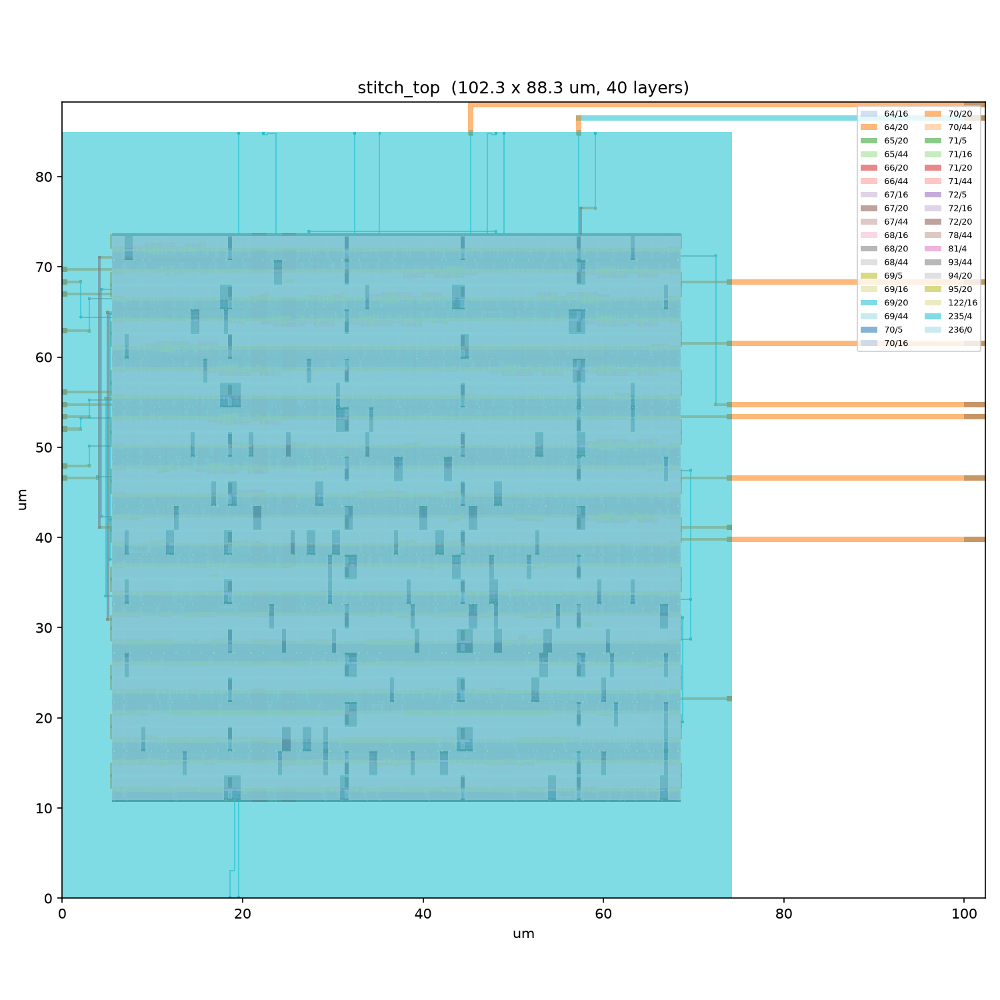
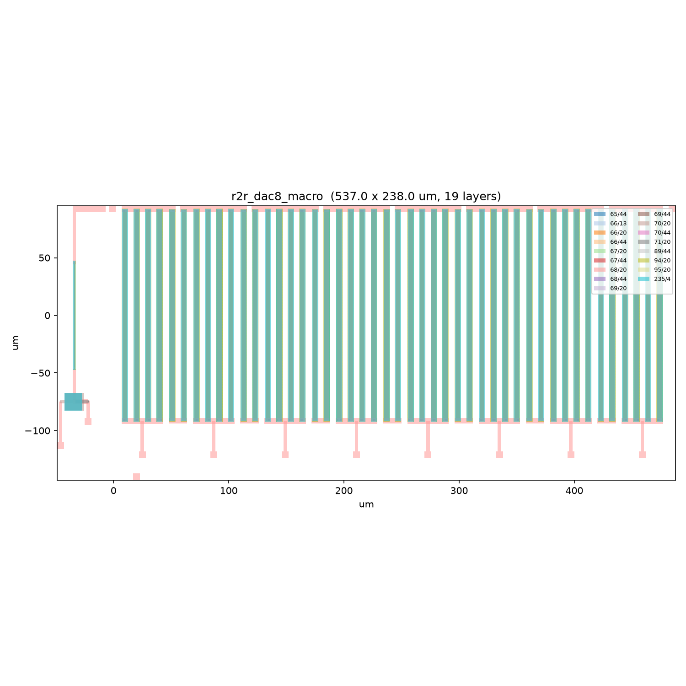
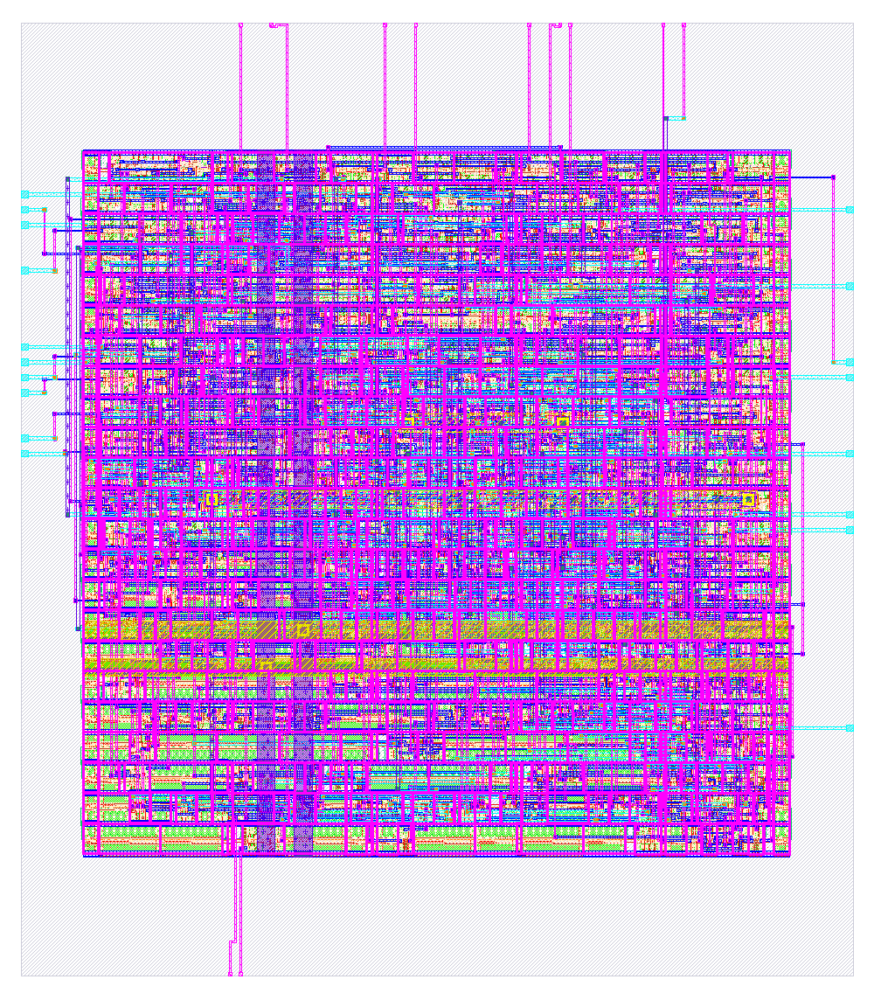
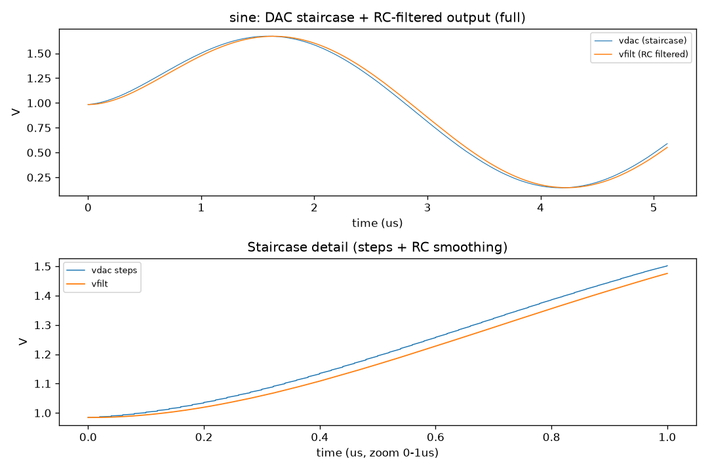
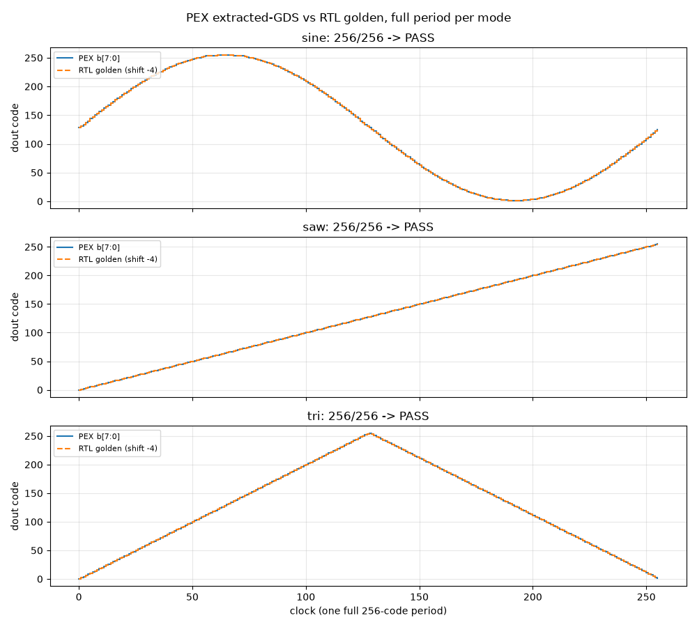

# waveform-generator — 8-bit programmable waveform generator

## 1. Summary

`waveform_gen` (synthesizable RTL: phase accumulator + 256-entry sine LUT +
saw/triangle modes) → `r2r_dac8` (8-bit R-2R ladder, CMOS transmission-gate
switches + polysilicon resistors) → `rc_filter` (first-order RC, ~3.4 MHz) →
nice signals. PDK sky130A, 50 MHz update, DNL/INL ≤ 1 LSB. This repo holds the
RTL, the PDK-mapped analog schematic, the PCell analog layout, the stitched
top GDS, and every script that reproduces them.

## 2. Managed through rocket-engine, built with Muse Spark

This project was created and run as a rocket-engine project: the engine
orchestrates open-source silicon tools — Icarus, yosys/LibreLane, ngspice,
xschem, Magic, Netgen, gdsfactory — behind one contract surface. The repo is
the project database: `rocket.yaml` declares the blocks and their I/O,
`canvas.toml` declares the design intent up front (50 MHz, 1.8 V, 8 bit,
DNL/INL ≤ 1 LSB), and every stage gates on verification (RTL golden codes,
DC sweeps, DRC, extraction reachability, extracted-GDS simulation) before the
next begins, with full artifact provenance in `exports/`.

Muse Spark worked inside that structure as the collaborating agent: the human
sets intent and inspects at every gate (schematic in xschem, GDS renders,
waveform plots), the agent executes the stages and brings back measured
evidence. Where an engine binding exists, the flow runs through it; where the
work is project-specific, handrolled generators plug in as tasks under the
same contracts — same results, fully reproducible, no hand-drawn polygons and
no hand-written netlists anywhere. That is the point of rocket: a human and
an AI agent co-developing real ASIC work in one repo, with the engine holding
the process together.

## 3. Schematic — generated headless, inspected in xschem



<p align="center"><em>Fig. 1 — Placement map of <code>r2r_dac8_pdk.sch</code>: 8 bit-slices (b7 top → b0 bottom), TG pairs + inverters per slice, R rungs, shunt taps, RFILT + MiM at right. Blue NMOS, red PMOS, orange poly-R, green cap.</em></p>

`design/analog/xschem/r2r_dac8_pdk.sch` (103 instances, 398 wires) is emitted
by `scripts/gen_analog_pdk.py`: 8 bit-slices (series-R rung + 2R shunt + W=20
TG pair + local inverter for the complementary select), vout trunk, RFILT +
15×15 MiM cap, physical rails. The figure above is rendered headless from the
`.sch` database by `scripts/plot_schematic.py` (blue NMOS, red PMOS, orange
poly-R, green cap). Open the same file in xschem to zoom the real thing —
`make touchcheck` (0 dangling nets) and `make pdkdac` (netlist + 256-code
sweep) run with no exports thanks to the project-local `./xschemrc`.

## 4. Layout

<table>
<tr>
<td width="68%" valign="top">


<p align="center"><em>Fig. 2 — stitched top: digital macro + analog straps.</em></p>

<table>
<tr>
<td width="50%" valign="top"><p align="center"><em>Fig. 3 — analog R-2R + RC macro.</em></p></td>
<td width="50%" valign="top"><p align="center"><em>Fig. 4 — digital waveform_gen macro.</em></p></td>
</tr>
</table>

</td>
<td width="32%" valign="top">

**Top — `stitch_top` (102×88 um).** LibreLane digital macro + 8 metal straps
to the analog `b[7:0]` pins. Magic DRC 0; extraction reaches all 8 pads.

**Bottom-left — `r2r_dac8_macro` (537×238 um).** The analog half, drawn with
sky130 PCells by `scripts/gen_analog_layout.py`: 15 folded poly-resistor
columns (46 legs, exact R/2R), segmented node trunk, 8 drain drops awaiting
the TG band, RFILT + MiM block at left. Magic DRC 0.

**Bottom-right — `waveform_gen` (74×85 um).** Digital macro out of LibreLane
(sky130A, DRC 0 / LVS 0): phase accumulator, mode mux, sine ROM.

</td>
</tr>
</table>

## 5. Metrics

| Metric | Value | How proven |
|---|---|---|
| Clock / supply / resolution | 50 MHz / 1.8 V / 8 bit | `canvas.toml` + Icarus TB, 256 codes/mode |
| Ideal-ladder DNL / INL | 0.0001 / 0.0001 LSB | ngspice DC sweep, `results/dnl_inl.txt` |
| PDK-ladder DNL / INL (tt) | 0.22 / 0.19 LSB | 256-code sweep on foundry models, PASS ≤ 1 LSB |
| LSB / full-scale | 7.03 mV / 0 → 1.793 V | measured, both ladders |
| Filter corner | ~3.4 MHz vs 195 kHz fundamental | light by design: smooths, barely phase-shifts |
| Digital macro | 74.2 × 85.0 um, DRC 0, LVS 0 | LibreLane sky130A |
| Analog macro | 537 × 238 um, DRC 0 (LVS pending) | Magic `drc(full)` on PCell GDS |
| Extracted-GDS function | 256/256 sine, saw, tri | ngspice on Magic-extracted `stitch_top` |
| Stitch connectivity | 8/8 pads extracted | `scripts/verify_extract.py` |

## 6. Waveform plots

Analog path (ideal SPICE: DAC staircase + filtered output):



<p align="center"><em>Fig. 5 — Ideal-SPICE sine: DAC staircase (blue) vs RC-filtered output (orange), full period + step detail showing the smoothing.</em></p>

Digital path through extracted silicon (PEX b[7:0] vs RTL golden, full period
per mode — sine, saw, triangle, all 256/256):



<p align="center"><em>Fig. 6 — Extracted-transistor simulation vs RTL golden codes: full 256-code periods, sine / saw / triangle, 256/256 each.</em></p>

## 7. Run, verify, prerequisites

Prerequisites: Icarus Verilog, ngspice-42, yosys, Magic 8.3 + Netgen (all
with sky130A at `~/.local/share/pdk/sky130A`), LibreLane AppRun, Python with
`matplotlib`/`numpy`, and the isolated PCell venv
(`requirements-gfsky130.txt`: `sky130==1.0.0` + `gdsfactory~=9.40.1`).

| Command | Proves |
|---|---|
| `iverilog … && vvp results/tb_wave` | RTL: 256 codes/mode vs golden |
| `make tran && make dnl` | ideal analog: staircase + DNL/INL ≤ 1 LSB |
| `make pdkdac` | PDK schematic → netlist → 256-code sweep (DNL 0.22/INL 0.19) |
| `make touchcheck` | xschem-side check: schematic has no dangling nets |
| `make analoglay` (+ Magic `drc(full)`) | analog macro GDS, DRC 0 |
| klayout verify scripts (`verify_stitch.py`, `verify_extract.py`) | klayout-side checks: stitch geometry + 8/8 pad extraction |
| `make pex` | extracted-GDS function, 256/256 × 3 modes |
| `make tbreplay` | flat PWL replay of the RTL golden through the PDK DAC (sine/saw) |
| `make tbexpand` | visitor tb schematics expand to decks bit-identical to the flat replay (sine/saw run + compare; tri runs) |
| `make tbxschem` | same schematics netlisted by real xschem (command mode, no X) run bit-identical too — this is what Simulate executes |
| open `design/analog/xschem/wave_top_tb_sine.sch`, Simulate | one button: the `.control` block runs the sweep, writes the raw/txt, and `plot`s `v(vout)`/`v(vfilt)` straight into ngspice's window — plus the embedded graph rect keeps the waves in the schematic (Ctrl+click the launcher to reload) |

Repo map: `rocket.yaml` manifest · `canvas.toml` intent · `design/digital/`
RTL · `design/analog/` SPICE + xschem + GDS · `tests/` benches ·
`scripts/` generators · `docs/` writeups (`pex_sim.md`, `magic_stitch.md`,
`architecture/`) · `exports/` GDS + screenshots.

### xschem bring-your-own-PDK: known path problems

Schematics here resolve symbols from three places: xschem's own `devices/`
(pins), the sky130A PDK (`sky130_fd_pr/`), and this repo (`r2r_dac8_pdk`,
`stair_stepper_*`). The project-local `./xschemrc` assembles that path, but
if you bring your own PDK layout or xschem install, these are the failures
we hit and their countermeasures:

| Symptom (`l_s_d(): Symbol not found`) | Cause | Fix |
|---|---|---|
| `devices/ipin`, `lab_pin`, … missing, PDK symbols fine | `XSCHEM_LIBRARY_PATH` exported with only the PDK dir — replaces xschem defaults | unset it; `./xschemrc` restores defaults, or append (`:…:$OLD`) instead of replacing |
| pins missing with no exports at all | an `append` created the var before defaults installed | fixed in repo: `xschemrc` resets via the vendor recipe, then appends |
| `sky130_fd_pr/…` missing | PDK not at `~/.local/share/pdk/sky130A` | point `./xschemrc`'s PDK line at your install, or set `XSCHEM_USER_LIBRARY_PATH` (auto-appended) |
| `r2r_dac8_pdk`, `stair_stepper_*` missing | project syms live next to the schematics, which xschem never searches | fixed in repo: `xschemrc` anchors `design/analog/xschem` + launch dir |
| everything missing | launched from another directory (`./xschemrc` not sourced) | launch from the repo root |

Self-check after opening: zero `l_s_d()` lines in the xschem console, FETs
render as sky130 symbols (not empty boxes), `make touchcheck` passes.

To adapt `./xschemrc` to your machine, only three spots ever need editing
(everything else is install defaults — leave it alone):

```tcl
# 1. where your PDK's xschem symbols live (default: standard pdk share dir)
set _pdk_lib $env(HOME)/.local/share/pdk/sky130A/libs.tech/xschem

# 2. where THIS repo keeps its own .sym files, anchored to the rc file
#    itself so the launch directory never matters:
append XSCHEM_LIBRARY_PATH :[file dirname [info script]]/design/analog/xschem

# 3. your private libs (optional, never edit the file for these):
#    export XSCHEM_USER_LIBRARY_PATH=/path/to/my/libs   # auto-appended
```

Rules of thumb: never `export XSCHEM_LIBRARY_PATH` yourself (it replaces the
defaults — append instead); never copy PDK symbols into the repo (reference,
don't vendor); always launch from the repo root so `./xschemrc` is sourced.

### Same flow, through engine API v1

If you wanted to redo everything above without touching a shell, this is what
you'd call — each row is a real `run.start` task from the v1 catalog, same
tools underneath, same evidence out:

| What we ran | Engine equivalent (`run.start`) |
|---|---|
| `iverilog` + `vvp` RTL sim | `simulate.hdl` (backend: icarus) |
| ngspice `tran` on `wave_top` | `simulate.spice` (mode: `tran`, backend: ngspice) |
| 256-code DC sweep for DNL/INL | `simulate.spice` (mode: `dc`) |
| DNL/INL + waveform + PEX check scripts | `analyze.measurements` (numpy/matplotlib) |
| yosys synth + LibreLane tapeout | `synthesize.hdl` → `implement.asic` (or `workflow.asic` for the whole ride) |
| xschem schematic → netlist | `generate.netlist` (adapter: xschem) |
| hierarchical tb expand + replay compare (`make tbexpand`) | `generate.netlist` (hierarchical) → `simulate.spice` (tran) → `analyze.measurements` (bit-compare vs golden) |
| xschem-native netlist + replay compare (`make tbxschem`) | `generate.netlist` (adapter: xschem) → `simulate.spice` (tran) → `analyze.measurements` (bit-compare vs golden) |
| PCell R-2R + filter layout | `generate.views` (library: gdsfactory) |
| `make touchcheck` (xschem verification) | `check.erc` + `check.connectivity` (electrical rules on the schematic) |
| klayout verify scripts (stitch + extraction) | `check.view_sync` (source vs laid-out vs extracted views, pin mappings) |
| Magic DRC | `check.drc` (adapter: magic or klayout) |
| Netgen LVS | `check.lvs` (adapter: netgen) |
| Magic parasitic extraction | `extract.layout` (adapter: magic) |
| Extracted-GDS transient vs golden | `workflow.analog` (netlist → simulate → compare extracted) |
| GDS merge + screenshot export | `export.design` (klayout/magic) |

<sub>Heads-up: the engine is under active development and some API names or payload fields may change between revisions — pin your contract bundle and re-check the catalog before scripting against it.</sub>

## Conclusion

The chain is proven in three independent layers — RTL simulation, foundry-
model analog simulation, and transistor-level simulation of extracted GDS —
with the layout generated, not drawn, at every step. What remains is the TG
switch band in the analog macro, LVS against the xschem source, and the
re-stitch: at that point `stitch_top` becomes real mixed-signal silicon and
this README's top figure gets re-rendered with it.
