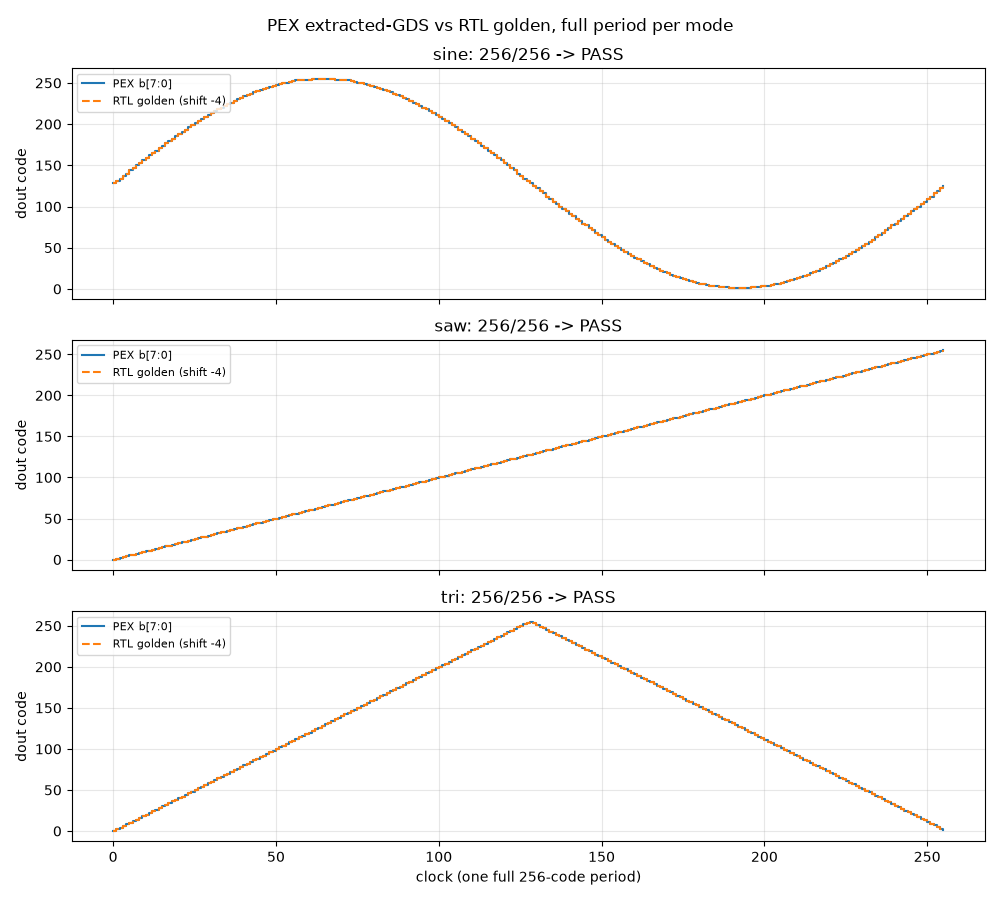

# PEX sim: does the extracted GDS actually waveform-generate?

Yes — for the digital path. `make pex` simulates the flat transistor netlist
Magic extracts from `stitch_top` (3,224 FETs + 88 node caps, C-only: this
extract style emits no wire resistors) for 262 clocks at 50 MHz in each of
sine/saw/tri mode, thresholds the `b[7:0]` strap nets at 0.9 V, and compares
against the 256-code RTL golden files.

Result (`results/pex_check.txt`): **256/256 per mode — PASS** (shift -4:
the extracted sim leads the Icarus golden by 4 clocks from TB reset/holdup
differences; the checker searches shifts -8..+8 modulo the 256-period).

## What this proves (and does not)

- Proves: the LibreLane macro + the 8 hand straps deliver correct codes at
  the `b[7:0]` pads, parasitics included. Connectivity (LVS-extract 8/8) and
  function (this sim) agree.
- Does not prove analog function: past `b[7:0]` there is no DAC or filter
  geometry yet — those pads float. The R-2R + RC proof stays in ideal SPICE
  (`results/waveform_check.txt`, DNL/INL 0.0001 LSB) until the analog macro
  is laid out and stitched for real.

## Reproduce

`scripts/gen_pex_tb.py` writes the deck (`--mode sine|saw|tri --nclk 262`);
`scripts/check_pex.py` checks + plots. The 452 KB extract
(`results/top_pex.spice`) is regenerable scratch (git-ignored) — see
`docs/magic_stitch.md` "Parasitic extraction". Two ngspice-42 gotchas are
handled in the scripts: `tran` must live inside `.control`, and bracket nets
(`step[0]`) simulate in a `sed`-renamed copy (`step_0`) because `v()` probes
reject brackets.
